# DER — Diagrama Entidade-Relacionamento · Vantix Tech Store

> MySQL 8 · InnoDB · utf8mb4. As explicações de entidades, cardinalidades e normalização estão em [MER.md](MER.md).
>
> **Imagem:** [diagramas/der.png](diagramas/der.png). As fontes (`mer.mmd` e `der.mmd`) ficam na mesma pasta; abra em https://mermaid.live para editar.
>
> **Como ler os tipos:** o Mermaid não aceita vírgula no tipo, então a precisão de `DECIMAL` e os valores de `ENUM` aparecem no comentário entre aspas. Exemplo: `DECIMAL preco "10,2"` significa `DECIMAL(10,2)`.
>
> **IDs:** no diagrama aparecem como `INT`; no `schema.sql` são `INT UNSIGNED` (não existe id negativo).
>
> **Cardinalidade (pé de galinha):** `||` exatamente um · `o|` zero ou um · `|{` um ou mais · `o{` zero ou mais.

```mermaid
erDiagram
    %% ===================== ACESSO E PESSOAS =====================
    perfil {
        INT id PK
        VARCHAR(20) codigo UK "cliente|gerente|estoque|logistica"
        VARCHAR(50) nome
        VARCHAR(255) descricao "NULL"
    }
    usuario {
        INT id PK
        INT perfil_id FK
        VARCHAR(100) nome
        VARCHAR(100) email UK
        VARCHAR(255) senha_hash "BCrypt"
        BOOLEAN ativo
        DATETIME criado_em
        DATETIME atualizado_em
    }
    cliente {
        INT id PK
        INT usuario_id FK,UK "NULL = compra sem conta"
        VARCHAR(100) nome
        VARCHAR(100) email UK
        VARCHAR(20) telefone
        DATETIME criado_em
        DATETIME atualizado_em
    }
    endereco {
        INT id PK
        INT cliente_id FK
        VARCHAR(30) apelido "NULL"
        CHAR(8) cep "NULL"
        VARCHAR(150) logradouro
        VARCHAR(10) numero
        VARCHAR(60) complemento "NULL"
        VARCHAR(80) bairro
        VARCHAR(80) cidade
        CHAR(2) uf
        BOOLEAN principal
        DATETIME criado_em
    }

    %% ===================== CATALOGO E ESTOQUE =====================
    categoria {
        INT id PK
        VARCHAR(100) nome UK
        TEXT descricao "NULL"
        DATETIME criado_em
    }
    produto {
        INT id PK
        INT categoria_id FK
        VARCHAR(150) nome
        TEXT descricao "NULL"
        VARCHAR(60) marca "NULL"
        DECIMAL preco "10,2 - CHECK > 0"
        DECIMAL preco_antigo "10,2 - NULL"
        VARCHAR(255) imagem_url "NULL"
        BOOLEAN destaque
        BOOLEAN disponivel
        DATETIME criado_em
        DATETIME atualizado_em
    }
    estoque {
        INT id PK
        INT produto_id FK,UK
        INT quantidade "CHECK >= 0"
        INT estoque_minimo
        DATETIME atualizado_em
    }
    movimentacao_estoque {
        INT id PK
        INT produto_id FK
        INT pedido_id FK "NULL"
        INT usuario_id FK "NULL"
        ENUM tipo "entrada|saida|ajuste|devolucao"
        INT quantidade
        INT saldo_apos
        VARCHAR(255) motivo "NULL"
        DATETIME criado_em
    }
    recomendacao {
        INT id PK
        INT produto_origem_id FK
        INT produto_recomendado_id FK
        ENUM tipo "manual|comprados_juntos|compatibilidade"
        DECIMAL peso "5,2"
        DATETIME criado_em
    }

    %% ===================== COMPRA =====================
    carrinho {
        INT id PK
        INT cliente_id FK "NULL = visitante"
        VARCHAR(64) token_sessao UK "NULL"
        ENUM status "aberto|convertido|abandonado"
        DATETIME criado_em
        DATETIME atualizado_em
    }
    carrinho_item {
        INT id PK
        INT carrinho_id FK
        INT produto_id FK
        INT quantidade "CHECK > 0"
        DATETIME adicionado_em
    }
    pedido {
        INT id PK
        VARCHAR(20) numero UK "VTX-1001"
        INT cliente_id FK
        INT carrinho_id FK,UK "NULL"
        INT montagem_id FK "NULL"
        ENUM status "pendente|confirmado|em_preparacao|pronto|saiu_para_entrega|entregue|cancelado"
        DECIMAL valor_total "10,2"
        TEXT observacoes "NULL"
        DATETIME criado_em
        DATETIME atualizado_em
    }
    pedido_item {
        INT id PK
        INT pedido_id FK
        INT produto_id FK
        INT quantidade "CHECK > 0"
        DECIMAL preco_unitario "10,2 - preco na data da venda"
        DECIMAL subtotal "10,2 - GENERATED"
    }
    pedido_status_historico {
        INT id PK
        INT pedido_id FK
        ENUM status_anterior "NULL na criacao"
        ENUM status_novo
        INT usuario_id FK "NULL = sistema/cliente"
        VARCHAR(255) observacao "NULL - ex. motivo do cancelamento"
        DATETIME criado_em
    }
    pagamento {
        INT id PK
        INT pedido_id FK,UK
        ENUM forma "credito|debito|pix|boleto"
        TINYINT parcelas "1 a 12"
        DECIMAL valor "10,2"
        ENUM status "pendente|aprovado|recusado|estornado"
        VARCHAR(64) codigo_transacao "NULL"
        DATETIME pago_em "NULL"
        DATETIME criado_em
    }
    entrega {
        INT id PK
        INT pedido_id FK,UK
        ENUM modalidade "entrega|retirada"
        INT entregador_id FK "NULL - usuario logistica"
        INT endereco_id FK "NULL - origem da copia"
        CHAR(8) cep "NULL"
        VARCHAR(150) logradouro "NULL"
        VARCHAR(10) numero "NULL"
        VARCHAR(60) complemento "NULL"
        VARCHAR(80) bairro "NULL"
        VARCHAR(80) cidade "NULL"
        CHAR(2) uf "NULL"
        DECIMAL valor_frete "10,2"
        VARCHAR(30) codigo_rastreio "NULL"
        DATE previsao_entrega "NULL"
        DATETIME saiu_em "NULL"
        DATETIME entregue_em "NULL"
    }

    %% ===================== INOVACOES (MONTAGEM DE PC) =====================
    especificacao_tecnica {
        INT id PK
        INT produto_id FK,UK
        ENUM tipo_peca "cpu|gpu|placa_mae|ram|ssd|hdd|fonte|cooler|gabinete"
        INT consumo_watts
        TINYINT score_desempenho "0 a 100"
        VARCHAR(20) soquete "NULL - cpu, placa_mae, cooler"
        ENUM tipo_memoria "DDR4|DDR5 - NULL"
        ENUM formato "ATX|mATX|ITX - NULL"
        INT vram_gb "NULL - gpu"
        INT capacidade_gb "NULL - ram, ssd, hdd"
        INT potencia_fonte_w "NULL - fonte"
        DECIMAL eficiencia_fonte "3,2 - NULL - 0.80|0.85|0.90"
    }
    tarifa_energia {
        INT id PK
        CHAR(2) uf UK
        VARCHAR(100) distribuidora
        DECIMAL valor_kwh "5,2 - R$ por kWh"
        DATETIME atualizado_em
    }
    montagem {
        INT id PK
        INT cliente_id FK "NULL = visitante/exemplo"
        VARCHAR(100) nome
        DECIMAL horas_uso_dia "4,1 - 1 a 24"
        CHAR(2) uf FK "tarifa_energia.uf"
        BOOLEAN exemplo
        DATETIME criado_em
    }
    montagem_item {
        INT id PK
        INT montagem_id FK
        INT produto_id FK
        INT quantidade "CHECK > 0"
    }
    software {
        INT id PK
        VARCHAR(100) nome UK
        ENUM tipo "jogo|programa"
        VARCHAR(50) categoria
        VARCHAR(255) imagem_url "NULL"
        INT popularidade
    }
    requisito {
        INT id PK
        INT software_id FK
        ENUM nivel "minimo|recomendado|ultra"
        TINYINT score_cpu_min
        TINYINT score_gpu_min
        INT ram_min_gb
        INT vram_min_gb
        INT armazenamento_gb
        INT fps_estimado "NULL para programa"
    }

    %% ===================== RELACIONAMENTOS =====================
    perfil          ||--o{ usuario                 : "atribuido a"
    usuario         |o--o| cliente                 : "conta de"
    cliente         ||--o{ endereco                : "cadastra"

    categoria       ||--o{ produto                 : "agrupa"
    produto         ||--|| estoque                 : "tem saldo"
    produto         ||--o{ movimentacao_estoque    : "movimenta"
    pedido          |o--o{ movimentacao_estoque    : "origina"
    usuario         |o--o{ movimentacao_estoque    : "registra"
    produto         ||--o{ recomendacao            : "origem"
    produto         ||--o{ recomendacao            : "recomendado"

    cliente         |o--o{ carrinho                : "possui"
    carrinho        ||--o{ carrinho_item           : "contem"
    produto         ||--o{ carrinho_item           : "esta em"
    cliente         ||--o{ pedido                  : "faz"
    carrinho        |o--o| pedido                  : "convertido em"
    pedido          ||--|{ pedido_item             : "contem"
    produto         ||--o{ pedido_item             : "vendido em"
    pedido          ||--|{ pedido_status_historico : "registra"
    usuario         |o--o{ pedido_status_historico : "altera"
    pedido          ||--|| pagamento               : "pago por"
    pedido          ||--|| entrega                 : "entregue por"
    usuario         |o--o{ entrega                 : "entregador"
    endereco        |o--o{ entrega                 : "origem"

    produto         ||--o| especificacao_tecnica   : "detalha"
    cliente         |o--o{ montagem                : "salva"
    tarifa_energia  ||--o{ montagem                : "tarifa da UF"
    montagem        ||--o{ montagem_item           : "contem"
    produto         ||--o{ montagem_item           : "usado em"
    montagem        |o--o{ pedido                  : "verificada no"
    software        ||--|{ requisito               : "exige"
```

## Índices previstos (detalhados no `schema.sql` da Etapa 2)

| Tabela | Índices além da PK e dos UNIQUE |
|---|---|
| Todas | Um índice em cada coluna FK (o InnoDB exige; declarados explicitamente) |
| usuario | `email` (UK, usado no login) |
| cliente | `telefone` (identificação "Meus pedidos") |
| produto | `nome`, `marca`, (`disponivel`, `destaque`), FULLTEXT(`nome`, `descricao`, `marca`) para a busca |
| pedido | `status`, `criado_em`, (`cliente_id`, `criado_em`) |
| pedido_status_historico | (`pedido_id`, `criado_em`) |
| movimentacao_estoque | (`produto_id`, `criado_em`) |
| especificacao_tecnica | `tipo_peca`, `soquete` (filtros do "Monte seu PC") |
| software | `nome` (autocompletar), `popularidade` |
| carrinho | (`cliente_id`, `status`) |

## Views previstas

| View | Uso |
|---|---|
| `vw_consumo_montagem` | **Nova.** Soma de W por montagem, mais a potência e a eficiência da fonte |
| `vw_faturamento_diario`, `vw_pedidos_por_status`, `vw_produtos_mais_vendidos`, `vw_formas_pagamento`, `vw_pedidos_por_hora` | Já existem; serão adaptadas aos novos nomes |
| `vw_estoque_baixo` | Adaptada: agora compara `estoque.quantidade` com `estoque.estoque_minimo` |
| `vw_comprados_juntos` | Já existe; base da recomendação pelo histórico |
